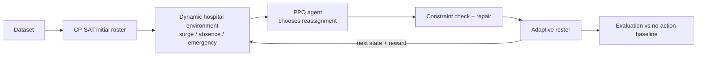

# An Intelligent RL Agent for Adaptive and Fair Hospital Workforce Scheduling Under Dynamic Conditions

**B.Tech Minor Project, Computer Engineering (AI & ML)**
Department of Computer Engineering, College of Technology, Silver Oak University, Ahmedabad (2026-2027)

**Author:** Vishwa Limbani (Enrollment No. 2301030600046)
**Internal Guide:** Mr. Sanket Shah
**Head of Department:** Dr. Vikas Tulshyan

> **Hybrid approach:**
> `CP-SAT Optimization → Dynamic Hospital Environment → PPO Agent → Adaptive Workforce Scheduling → Evaluation`

---

## Table of Contents

1. [Abstract](#1-abstract)
2. [Problem Statement](#2-problem-statement)
3. [Research Objectives](#3-research-objectives)
4. [Proposed Methodology](#4-proposed-methodology)
5. [System Architecture](#5-system-architecture)
6. [Technologies Used](#6-technologies-used)
7. [Dataset Description](#7-dataset-description)

---

## 1. Abstract

A hospital roster has to be right on every shift, but the conditions it was planned for keep changing. Patient demand rises without warning, staff call in sick, some skills such as ventilator certification are held by only a few people, and employees expect rest rules and a fair share of night work to be respected.

This project builds a reinforcement learning (RL) agent for adaptive and fair hospital workforce scheduling. A constraint programming solver (Google OR-Tools CP-SAT) first produces an initial feasible roster from staff, skill, availability and demand data. A Proximal Policy Optimisation (PPO) agent then adjusts the roster when disruptions such as demand surges, absences and emergencies occur, using a multi-objective reward that covers staffing adequacy, overtime, conflicts, fairness and workload balance. A repair step keeps every adjustment valid. The system is presented through a web dashboard named **Fair Roster**.

Compared with a no-action baseline on the same disruption scenarios, the mean staffing shortage fell from 106.01 to 0.9476, the mean skill shortage from 14.1381 to 0, 99.2% of disruption events were resolved, and the workload Gini coefficient fell from 0.4569 to 0.17. The Gini value is still above the project target (0.07) and the evaluation covers a limited dataset, so the results are a promising first step, not proof of readiness for a live hospital.

**Keywords:** Hospital workforce scheduling · Reinforcement learning · Proximal Policy Optimisation · Constraint programming · Workload fairness · Dynamic staffing

---

## 2. Problem Statement

Given the staff, skills, availability and preferences of a hospital, the demand for each unit and shift, and a stream of unexpected events that change the real situation during operation, how can a scheduling system decide how to reassign staff so that:

- shortages are removed,
- the required skills stay covered,
- workload stays fair,
- working rules are never broken, and
- the hospital keeps running smoothly?

Today, most rosters are built once (often in a spreadsheet) and then patched by phone calls. This is slow, easy to get wrong on skill requirements, tends to overload the same people, and leaves no record of why a change was made. A solver on its own also cannot react during operation without re-solving from scratch.

---

## 3. Research Objectives

1. Develop an RL framework for adaptive and fair hospital workforce scheduling.
2. Consider patient demand, staff availability, skills and certifications, shift requirements and employee preferences in each scheduling decision.
3. Reduce staffing shortages while keeping required skills covered on every shift.
4. Promote an equitable distribution of workload among staff.
5. Support adaptive reassignment of staff during demand surges, absences and other unexpected shortages.
6. Compare the agent with a no-action baseline using shortage, skill coverage, event resolution and fairness metrics.
7. Present the roster and the agent's actions through an interactive dashboard.

---

## 4. Proposed Methodology

The system follows a five-stage methodology:

1. **Data input and preprocessing:** the hospital dataset is cleaned and validated, missing values are handled, features are encoded, and staff-skill-shift relationships are built.
2. **Demand and constraint modelling:** demand is estimated, scenarios are generated for normal and surge conditions, and hard and soft rules are defined.
3. **Baseline and RL framework:** CP-SAT builds the initial feasible roster; the PPO agent observes the state and chooses reassignment actions.
4. **Training and validation:** PPO policy and value updates with constraint handling; convergence, stability and hyperparameter checks.
5. **Outputs and visualisation:** optimised roster, performance reports and the Fair Roster dashboard.

### Disruption events

| Event | Representation | Effect |
|---|---|---|
| Demand surge | Required staff rises above the planned level | More staff needed on the shift |
| Absence | A rostered person becomes unavailable | Shortage, possibly a skill gap |
| Emergency | Sudden extra load on a unit | Short-notice shortage |

### Hard and soft rules

| Type | Rule | Meaning |
|---|---|---|
| Hard | Availability | A person on leave or absent cannot be assigned |
| Hard | Skill requirement | A shift that needs a skill is filled by someone who holds it |
| Hard | Rest and shift pattern | Labour-law rest between shifts is respected |
| Hard | One shift at a time | A person works at most one shift in a period |
| Soft | Coverage | Demand is met as closely as possible |
| Soft | Overtime | Overtime is kept low |
| Soft | Preferences | Employee preferences are met where possible |
| Soft | Fairness | Workload is spread evenly across staff |

### RL agent design

- **State:** demand, staff, skills, availability, workload and preferences.
- **Action:** move a qualified, available staff member to the unit and shift that has a gap, or make no change.
- **Reward:** a weighted combination of staffing adequacy, overtime, conflicts, fairness and workload balance:

  `R = w₁·Adequacy − w₂·Overtime − w₃·Conflicts + w₄·Fairness + w₅·Balance`

- **Policy optimisation:** PPO with the clipped objective

  `rₜ(θ) = πθ(aₜ | sₜ) / πθ_old(aₜ | sₜ)`
  `L(θ) = E[ min( rₜ(θ)Âₜ , clip( rₜ(θ), 1 − ε, 1 + ε )Âₜ ) ]`

- **Constraint handling and repair:** every proposed action is checked against the rules and repaired into a valid roster if needed. Two variants are evaluated: *PPO with repair* and *CP-SAT with repair*.

---

## 5. System Architecture

The dataset enters the data processing layer, where it is cleaned, turned into features and structured. The structured data feeds the RL agent (state, policy, reward). The agent sends actions to the optimisation engine, which applies constraints and generates the roster using CP-SAT and RL. The evaluation engine computes metrics and compares with the baseline, and the dashboard visualises the results. The environment (the hospital under demand changes, absences and emergencies) returns the next state and feedback, so the loop continues.

| Module | Responsibility |
|---|---|
| Data processing layer | Cleans the dataset and builds staff-skill-shift relationships |
| CP-SAT baseline | Produces the initial feasible roster under the working rules |
| Environment | Simulates demand changes, absences and emergencies |
| RL agent (PPO) | Chooses reassignments based on the state and the reward |
| Optimisation engine | Applies constraints and the repair step to produce a valid roster |
| Evaluation engine | Computes metrics and compares with the baseline |
| Dashboard (Fair Roster) | Shows results; lets the user edit the roster and run the agent |

<!-- TODO: add architecture image, e.g.  -->

### Fair Roster dashboard

Six pages: **Overview, Roster, Disruptions, Fairness, Staff, Performance**. The Overview shows shift coverage, open positions, skill gaps, the Gini value, coverage by unit, who is on shift today and the agent activity log. The Roster page shows a staff-by-day grid (D / E / N shifts), unit filters, **Copy as CSV** and **Run agent optimizer** buttons. Light and dark modes are supported. The demo uses sample data for "Metro General Hospital" (20 staff, 3 units: ICU, ER, Ward).

<!-- TODO: add screenshots, e.g.   -->

---

## 6. Technologies Used

| Item | Description |
|---|---|
| Language | Python 3.13 |
| Constraint solver | Google OR-Tools CP-SAT |
| RL algorithm | Proximal Policy Optimisation (PPO) |
| Deep learning library | PyTorch 2.14.0 (CPU) |
| Data handling | Pandas, NumPy |
| Dashboard | HTML, CSS (web-based) <!-- TODO: add framework/backend used --> |
| Dataset | `hospital_hrm_dataset.xlsx` |
| Development machine | Laptop, AMD Ryzen 7 5800H, 24 GB RAM, Windows 11 |

---

## 7. Dataset Description

The project uses one workbook, `hospital_hrm_dataset.xlsx`.

| Data | Content | Records | Used for |
|---|---|---|---|
| Staff | Profiles, home units, roles, contracted hours | 265 | Assignments, workload |
| Skills and certifications | Qualifications and skill codes (ICU, ventilation, paediatric, operating-room related) | 365 | Skill coverage |
| Availability | Availability for particular dates and shifts | 44,520 | Feasibility of moves |
| Demand | Required staffing levels and minimum skill requirements per unit, date and shift | 840 | Coverage requirements, scenarios |
| Preferences | Shift preferences and requested time off | 2,895 | Reward and soft rules |

> The dashboard demonstration uses a separate small sample (Metro General Hospital, 20 staff, 3 units).
> <!-- TODO: state whether the dataset is included in the repo or why not (e.g. privacy / size) -->

---

